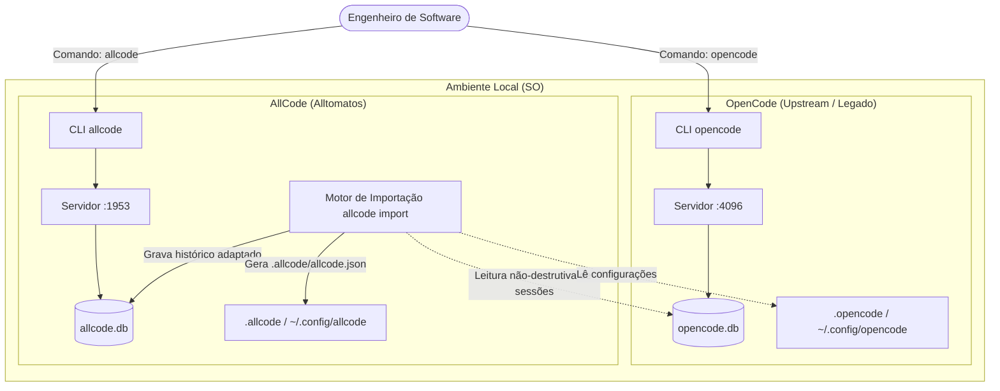
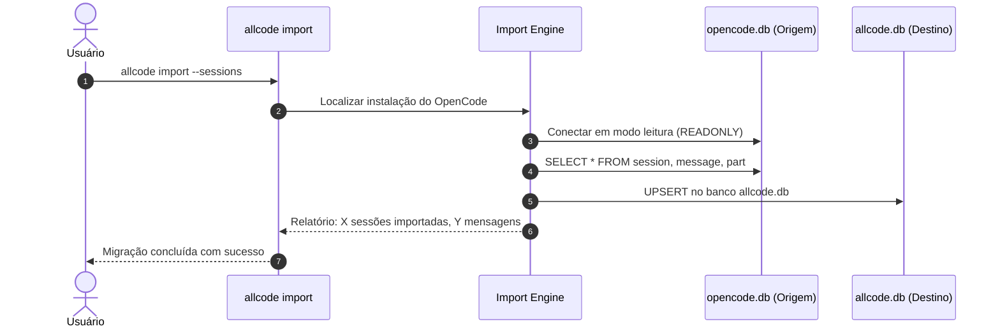

# Architecture Design Document (ADD): AllCode Platform & Side-by-Side Coexistence

## 1. Visão Geral e Objetivos do Produto

O **AllCode** é uma plataforma avançada para agentes de engenharia de software e interação interativa de código desenvolvida pela Alltomatos. O projeto origina-se como uma evolução especializada do OpenCode, incorporando inteligência orquestrada (Breniac), suporte integrado a desktop, ecossistema mobile e roteamento de modelos de alta resiliência.

### Objetivos Arquiteturais:
1. **Independência Operacional:** Capacidade de instalação, execução e empacotamento 100% isolados.
2. **Coexistência Sem Conflitos (Side-by-Side):** Usuários podem manter o `opencode` instalado e rodando em background na porta 4096 enquanto o `allcode` opera na porta 1953, com bancos de dados SQLite distintos e sem interferência em caches de plugins ou credenciais.
3. **Migração Suave (Onboarding):** Mecanismo de importação de sessões e projetos legados via comando `allcode import`.

---

## 2. Diagrama de Contexto de Coexistência (C4 Context)

---

## 3. Matriz de Isolamento de Recursos

| Recurso | OpenCode | AllCode | Mecanismo de Resolução |
| :--- | :--- | :--- | :--- |
| **Binário CLI** | `opencode` | `allcode` | `package.json` bin entrypoint |
| **Porta HTTP/WebSocket Padrão** | `4096` | `1953` | Flag de inicialização e default em `Branding.DEFAULT_PORT` |
| **App ID Desktop (Electron)** | `ai.opencode.desktop` | `ai.allcode.desktop` | `electron-builder.config.ts` |
| **Esquema de Protocolo URL** | `opencode://` | `allcode://` | Protocol Handler do SO |
| **Diretório Global de Config** | `~/.config/opencode` | `~/.config/allcode` | `Global.Path.config` |
| **Diretório Global de Dados** | `~/.local/share/opencode` | `~/.local/share/allcode` | `Global.Path.data` |
| **Banco SQLite Global** | `opencode.db` | `allcode.db` | `Database.path()` |
| **Diretório do Projeto** | `.opencode/` | `.allcode/` | `ConfigPaths.directories()` |
| **Arquivo de Configuração** | `opencode.json(c)` | `allcode.json(c)` | `ConfigPaths.files()` |
| **Prefixo de Variáveis de Ambiente** | `OPENCODE_*` | `ALLCODE_*` (com fallback) | `Flag.ts` / Env Parser |

---

## 4. Arquitetura do Motor de Importação (`allcode import`)

O motor de importação opera sob três premissas fundamentais:
1. **Totalmente Read-Only na Origem:** O banco `opencode.db` e o diretório `.opencode` do projeto nunca sofrem modificações ou remoções pelo AllCode.
2. **Idempotência:** A importação de sessões pode ser executada repetidas vezes sem duplicar sessões existentes (baseada em reconciliação por Session ID).
3. **Mapeamento de Schema:** O AllCode lê as tabelas `session`, `message`, `part` e eventos associados, ajustando referências caso necessário e gravando no `allcode.db`.

---

## 5. Diretrizes de Implementação

1. **Camada de Constantes de Plataforma:**
   - Criar `packages/core/src/platform/branding.ts` exportando constantes estruturadas de sistema (`NAME`, `APP_DIR`, `DEFAULT_PORT`, `DB_NAME`, `CONFIG_FILES`).
2. **Adequação Não-Intrusiva:**
   - Alterar pontos de resolução em `Global.Path`, `Database.path`, `ConfigPaths` e CLI para consumir as constantes de branding.
3. **Verificação de Tipos e Testes:**
   - Executar `bun typecheck` e testes de sistema para assegurar regressão zero.
