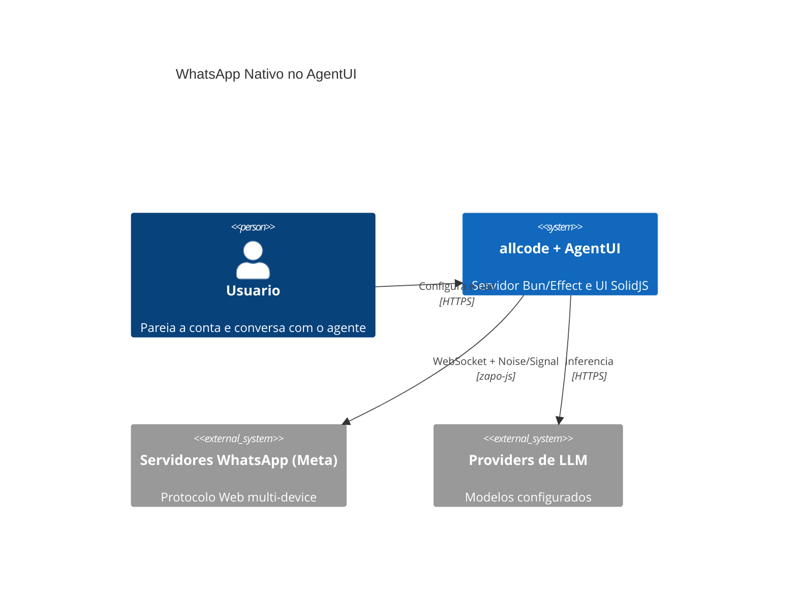
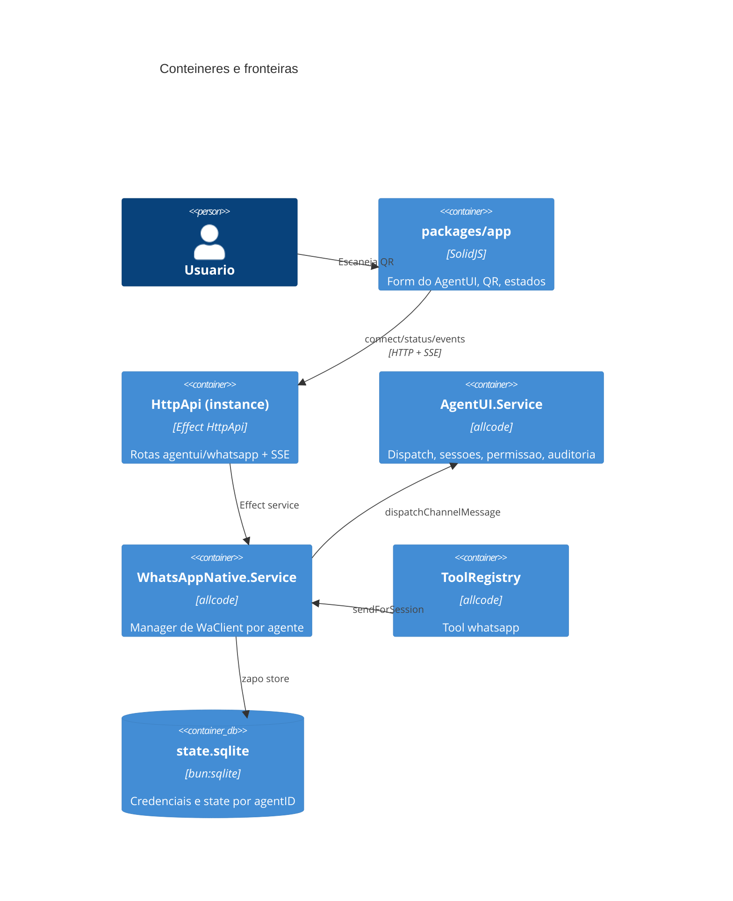
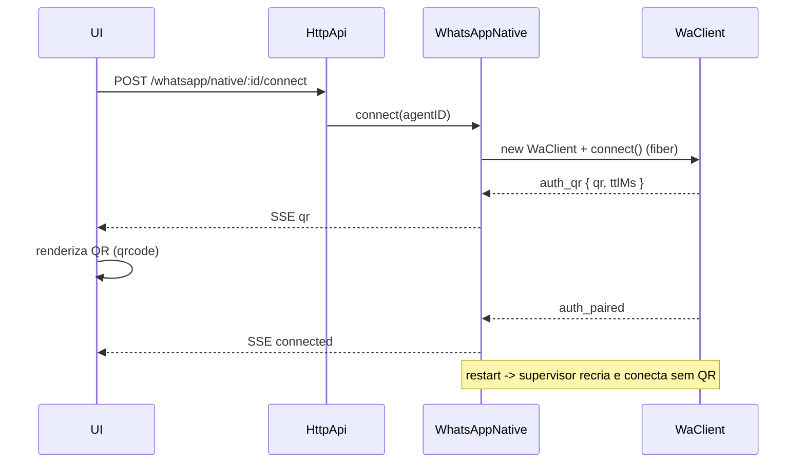
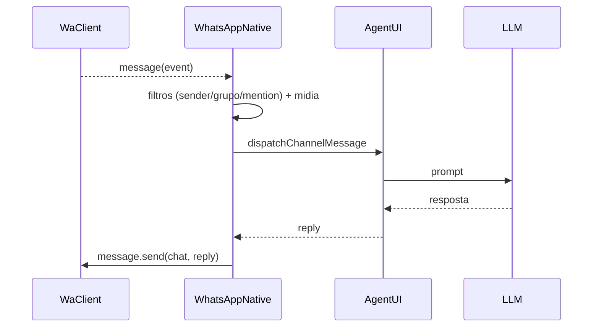

# ADD 0006: WhatsApp Nativo no AgentUI (zapo)

## 1. Visao Geral e Contexto de Negocio

### 1.1 Objetivo
Integrar a biblioteca `zapo-js` (protocolo WhatsApp Web nativo, fork `alltomatos/zapo`) ao allcode como dependencia interna, permitindo que o AgentUI:

- pareie uma conta WhatsApp por QR Code direto no painel, sem gateway externo;
- persista e restaure a sessao entre reinicios do processo;
- exponha ao assistente de IA tools reais de WhatsApp (envio, midia, leitura, grupos, reacoes);
- receba mensagens e responda pelo mesmo pipeline conversacional ja usado pelos canais Telegram e WhatsApp-via-webhook.

### 1.2 Escopo
Dentro do escopo:

- novo servico `WhatsAppNative` em `packages/allcode/src/whatsapp-native/`;
- extensao retrocompativel de `ConfigAgentUIV1.WhatsAppChannelBinding` com `provider: "zapo"`;
- endpoints HTTP/SSE de pareamento e status;
- tool `whatsapp` registrada no `ToolRegistry`;
- UI de conexao em `packages/app/src/pages/agentui-form.tsx`;
- testes de integracao com `@zapo-js/fake-server`.

Fora do escopo (v1):

- multiplas contas por agente;
- chamadas de voz/video (`voip`);
- newsletters/canais;
- migracao automatica de sessoes do `waconector` para o `zapo`.

### 1.3 Stakeholders
- Usuario final do AgentUI (pareia a conta e opera o agente).
- Time de plataforma allcode (servico, contratos HTTP, tools).
- Time de UI (painel de configuracao do agente).

---

## 2. Requisitos Nao Funcionais (NFRs)

| Categoria | Requisito |
|---|---|
| Disponibilidade | Falha de um agente nao derruba o processo nem os demais agentes; reconexao supervisionada com backoff |
| Latencia | Inbound: evento `message` despachado em < 200 ms ate `dispatchChannelMessage` (sem contar o LLM) |
| Persistencia | Sessao sobrevive a restart; credenciais em SQLite local |
| Seguranca | QR e credenciais nunca em log; diretorio `0700`, arquivo `0600`; allowlist de destinatarios opcional; rate limit de envio |
| Observabilidade | Logs estruturados por agente; estados `disconnected/connecting/qr/connected/error` expostos |
| Compatibilidade | Configs existentes (`waha`, `izapia`, etc.) continuam validas e funcionando |
| Testabilidade | Testes sem WhatsApp real via `@zapo-js/fake-server` |
| Custo | Zero infraestrutura adicional; conexao direta da maquina do usuario |

---

## 3. Decisoes Arquiteturais (resolvidas)

| ID | Decisao | Justificativa |
|---|---|---|
| D1 | Dependencia via npm `zapo-js@1.10.0` + `@zapo-js/store-sqlite` | Fork e espelho limpo do upstream; versao publicada coincide; sem build local no CI |
| D2 | Uma conta WhatsApp por agente (`sessionId = agentID`) | Isolamento total, sem risco de resposta cruzada; atende ao caso de uso atual |
| D3 | Store SQLite via `bun:sqlite` (`driver: "auto"`) | Sem modulo nativo adicional; `@zapo-js/store-sqlite` detecta Bun |
| D4 | QR/estado por SSE dedicado por agente | `/event` global filtra por `instance.directory`; QR pertence a config global e pode ser aberto em qualquer projeto |
| D5 | Reconexao no nosso supervisor, nao na lib | `WaClient.disconnect/close` nao reconecta; padrao ja usado no Telegram |
| D6 | Tool unica `whatsapp` com `action` | Segue o padrao de `reminder`; reduz superficie de schema e permissao |
| D7 | Nenhuma alteracao no fork `zapo` | Restricao explicita do solicitante |

---

## 4. Visao de Arquitetura (C4)

### 4.1 Contexto



### 4.2 Conteineres



### 4.3 Fluxo de pareamento



### 4.4 Fluxo inbound



---

## 5. Modelo de Dados e Persistencia

- `Global.Path.data/whatsapp-native/state.sqlite` (diretorio `0700`, arquivo `0600`).
- `createStore` unico no servico; `providers` persistentes para auth, signal, preKey, session, identity, senderKey, appState, privacyToken, messages, threads, contacts.
- `sessionId = agentID` isola credenciais e historico por agente.
- Logout: `client.logout()` + `logoutStoreClear` (auth e dominios nao-mailbox) e remocao da fibra.
- Nenhum dado de sessao vai para o config global (apenas flags nao sensiveis).

---

## 6. Comunicacao, APIs e Integracoes

### 6.1 Endpoints (grupo `whatsapp`)

| Metodo | Rota | Descricao |
|---|---|---|
| GET | `/whatsapp/native/:agentId` | Snapshot: estado, `meJid` mascarado, `connectedAt`, ultimo erro |
| POST | `/whatsapp/native/:agentId/connect` | Inicia pareamento (idempotente; nao bloqueia) |
| POST | `/whatsapp/native/:agentId/logout` | Desconecta e limpa credenciais |
| GET | `/whatsapp/native/:agentId/events` | SSE: `{ agentId, state, qr?, ttlMs?, error? }` |

Erros tipados: `WhatsAppNativeNotConfiguredError`, `WhatsAppNativeStateError`, `WhatsAppNativeOperationError`.

Depois de alterar o HttpApi: `bun run generate` em `packages/client` (nunca editar `src/generated*`).

### 6.2 Config

`ConfigAgentUIV1.WhatsAppChannelBinding`:

```ts
{
  type: "whatsapp"
  provider: "zapo" | "waha" | ... // zapo adicionado
  config: Record<string, string>
  webhookSecret?: string // passa a opcional (antes obrigatorio)
  sessionIds?: string[]
  allowedGroups?: string[]
  allowedSenders?: string[]
  groupAllowedSenders?: Record<string, string[]>
  mentionOnly?: boolean
  directory?: string
  native?: {
    autoStart?: boolean
    deviceBrowser?: string
    deviceOsDisplayName?: string
    sendRateLimitPerMinute?: number
    allowGroupAdmin?: boolean
  }
}
```

`Agent` ganha `whatsappEnabled?: boolean` (mesmo padrao de `agendaEnabled`).

Retrocompatibilidade: campos novos opcionais; `webhookSecret` opcional continua parseando configs antigas.

---

## 7. Tools Expostas ao Agente

Tool `whatsapp` (`packages/allcode/src/tool/whatsapp.ts`), permissao `whatsapp`:

| Action | Parametros principais |
|---|---|
| `send_text` | `to`, `text`, `quoteMessageId?` |
| `send_media` | `to`, `path` ou `url`, `caption?`, `kind?` |
| `status` | — |
| `list_chats` | `limit?` (de `threads.list`) |
| `read_messages` | `chatId`, `limit?`, `beforeTimestampMs?` |
| `react` | `chatId`, `messageId`, `emoji` |
| `group_list` | `limit?` |
| `group_info` | `groupId` |
| `group_create` | `subject`, `participants[]` |
| `group_update_participants` | `groupId`, `add[]`, `remove[]` |

Resolucao do agente: `AgentUI.agentForSession(sessionID)` (novo contrato, preenchido ao criar sessoes de canal/sandbox). Sem binding, a tool retorna erro compreensivel, nunca lanca.

Acoes administrativas de grupo respeitam `native.allowGroupAdmin`; envios respeitam `sendRateLimitPerMinute` e allowlist.

---

## 8. Resiliencia, Seguranca e Observabilidade

### 8.1 Resiliencia
- Supervisor `reconcile` a cada 5 s sobre `agentui.list()` (padrao `telegram/index.ts:1038-1153`).
- Backoff exponencial `2s -> 60s` para `connection close` sem `isLogout`.
- Todo handler com `Effect.catchCause`; erro de um agente nao afeta os outros.
- Envio com `messageMaxAttempts` da lib + mapeamento de erros (`timeout`, `rate_limit`, `invalid_recipient`, `disconnected`).

### 8.2 Seguranca (OWASP)
- QR e credenciais nunca logados; JIDs/telefones mascarados.
- Validacao de entrada em todas as tools (`Schema`), inclusive `to`/`groupId`.
- Allowlist de destinatarios opcional; `mentionOnly` e `allowedGroups` mantidos.
- Sem shell/filesystem habilitados por consequencia do canal.
- Auditoria via `AgentUI.logAudit` para cada turno.

### 8.3 Observabilidade
- Logs `Effect.log*` com `agentId`, `state`, `reason` (sem conteudo sensivel).
- Contadores: conexoes ativas, mensagens recebidas/enviadas, falhas por tipo.
- Golden signals mapeados para o serviço: latencia de envio, trafego, erros, sessoes saturadas.

---

## 9. Plano de Implementacao

| Fase | Escopo | Aceite |
|---|---|---|
| M0 | deps npm, `store.ts`, spike `connect()` | Pareia via QR e persiste em `bun:sqlite` |
| M1 | `manager.ts`, `service.ts`, endpoints, SSE, UI de QR | QR -> connected sem restart; restart restaura; logout limpa |
| M2 | `inbound.ts` + filtros + midia + reply | Mensagem recebida responde no mesmo chat; grupos respeitam regras |
| M3 | tool `whatsapp` + `whatsappEnabled` + `agentForSession` | Comando em linguagem natural executa e retorna resultado |
| M4 | testes (`test/whatsapp-native.test.ts`, `*.spec.sec.ts`), codegen, hardening | `bun typecheck` e `bun test` verdes |

### 9.1 Arquivos

Criar:
- `packages/allcode/src/whatsapp-native/{service,manager,store,inbound,events,supervisor,schema}.ts`
- `packages/allcode/src/tool/whatsapp.ts` + `whatsapp.txt`
- `packages/allcode/test/whatsapp-native.test.ts`

Alterar:
- `packages/core/src/v1/config/agentui.ts`
- `packages/allcode/src/agentui/index.ts`
- `packages/allcode/src/tool/registry.ts`
- `packages/allcode/src/server/routes/instance/httpapi/groups/whatsapp.ts`
- `packages/allcode/src/server/routes/instance/httpapi/handlers/whatsapp.ts`
- `packages/allcode/src/server/routes/instance/httpapi/api.ts` (se houver novo grupo)
- `packages/app/src/pages/agentui-form.tsx`
- `packages/app/src/i18n/en.ts` e `pt-BR` (se existir)
- `packages/client/src/generated*` via `bun run generate` (nunca manual)

---

## 10. Riscos e Mitigacoes

| Risco | Mitigacao |
|---|---|
| API do `zapo` mudar em minor | Pin `1.10.0`; upgrade exige rodar M0 |
| Sessao corrompida apos crash | `logoutStoreClear` + recriacao; QR re-pareia |
| Mensagens duplicadas em reconnect | Deduplicacao por `key.id` (mesmo padrao do webhook atual) |
| Tool chamada em sessao sem agente | `agentForSession` retorna `undefined` -> erro claro, sem throw |
| Permissao nao concedida em sessao de canal | Regra `allow` em `sessionPermission` (canal nao tem humano para aprovar) |
| QR exposto em log de debug | Logger adapter sem payload de QR/credenciais |
| `bun:sqlite` indisponivel | `driver: "auto"` cai para `better-sqlite3`/`node:sqlite` |

---

## 11. Fora de Escopo / Debito Futuro

- Multi-conta por agente (exigira `sessionId` explicito na tool).
- Migracao de sessoes existentes do `waconector`.
- `voip`, newsletters e canais.
- Criptografia em repouso do SQLite (hoje protegido por permissao de arquivo).
